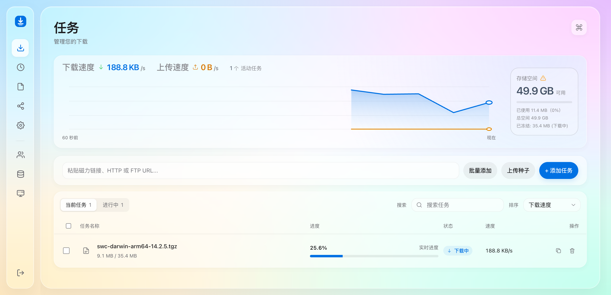
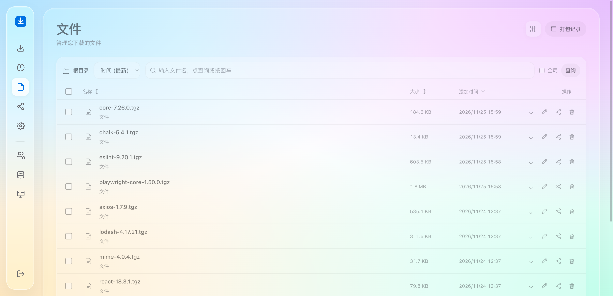
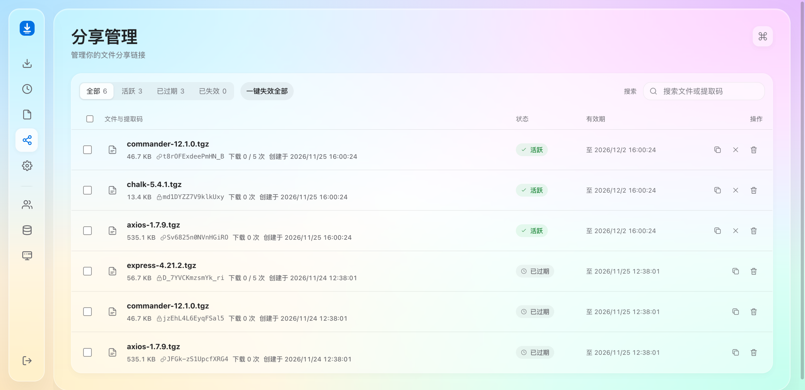
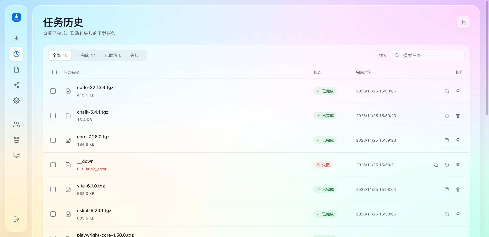

<div align="center">

# Aria2Deck

**基于 aria2 的多用户下载管理平台**

一套 Web 界面搞定：添加任务、管理文件、多人协作、分享下载

[](#)
[](LICENSE)
[](https://github.com/crmmc/aria2deck/pkgs/container/aria2deck)

</div>

<br>

## 功能亮点

**下载任务** — 支持磁力链接、种子文件、HTTP/HTTPS/FTP。可一次粘贴多个链接批量添加；上传种子时能预览完整文件树，勾选其中一部分下载。任务进度、速度曲线与状态变化通过 WebSocket 实时推送，完成或失败可触发浏览器桌面通知。

**任务历史** — 完整保留完成、失败、取消三种终态，按状态筛选、按名称搜索、支持单条重试与批量清理，并按保留天数自动回收。

**文件管理** — 目录结构浏览、文件名搜索、按时间或大小排序，支持重命名、下载、删除与批量操作。多选文件可打包成 ZIP 或 TAR.ZST 下载（格式与压缩级别由管理员在系统设置里指定），打包进度在「打包记录」抽屉里追踪，随时可取消。

**文件分享** — 生成分享链接，支持密码保护、有效期和下载次数上限，可单条撤销或一键失效全部。公开分享页免登录访问，同样支持目录浏览与逐文件下载。

**存储管理** — 管理员视角按内容哈希查看全部存储对象：大小、引用数、磁盘状态、引用用户，可清除无人引用的内容。

**未登记文件** — 扫描下载目录里磁盘上有、库里没登记的对象（升级丢数据、异常中断留下的残留），列出来交管理员决策：加入入库队列，由管理员挑合适时机开始校验入库，下次下载同内容时直接复用；或直接删除腾出空间。队列在后台逐条处理、可随时停止，处理中的条目也能看到当前进度。

**多用户隔离** — 每用户独立的任务列表、文件空间和存储配额，管理员可创建账号、分配配额、调整角色。同一资源被多人下载时自动复用已有内容，不重复占用磁盘和带宽。

**系统设置** — 基础配置、aria2 后端（连通性测试与版本查询）、打包、实时连接、Tracker 列表（支持远程源刷新）、安全与限流（各类接口限流、下载连接数，以及一键作废全部 API Token 与 RPC Secret）。

**外部客户端** — 内置 aria2 JSON-RPC 兼容端点，可对接 AriaNg、Motrix 等客户端；每用户独立 RPC Secret。

**界面** — 桌面端可折叠侧栏，移动端自动切换为底部导航；`⌘K` / `Ctrl+K` 调出快捷操作面板直接跳转功能与设置项。

<br>

## 界面预览

<table>
  <tr>
    <td align="center"><br><sub>任务管理</sub></td>
    <td align="center"><br><sub>文件管理</sub></td>
  </tr>
  <tr>
    <td align="center"><br><sub>分享管理</sub></td>
    <td align="center"><br><sub>任务历史</sub></td>
  </tr>
</table>

<br>

## 快速开始

### Docker Compose（推荐）

```bash
git clone https://github.com/crmmc/aria2deck.git
cd aria2deck
export ARIA2DECK_ARIA2_RPC_SECRET="$(openssl rand -hex 32)"
export ARIA2DECK_SHARE_JWT_SECRET="$(openssl rand -hex 32)"
export ARIA2DECK_CREDENTIAL_PEPPER="$(openssl rand -hex 32)"
read -rsp "初始管理员密码（至少 16 个字符）: " ARIA2DECK_INITIAL_ADMIN_PASSWORD
export ARIA2DECK_INITIAL_ADMIN_PASSWORD
printf '\n'
make docker-up
```

浏览器打开 `http://localhost:8001`，使用账号 `admin` 和上面设置的初始密码登录。已有管理员的升级部署可省略 `ARIA2DECK_INITIAL_ADMIN_PASSWORD`。

以上三个 secret 中，`ARIA2DECK_ARIA2_RPC_SECRET`、`ARIA2DECK_SHARE_JWT_SECRET`、`ARIA2DECK_CREDENTIAL_PEPPER` 缺失时 Compose 会直接拒绝启动；后两个必须各自至少 32 字节且互不相同，否则后端启动即报配置错误。

### 独立 Docker 运行

先按上文导出变量；已有管理员时可省略 `ARIA2DECK_INITIAL_ADMIN_PASSWORD`。

```bash
docker run -d \
  --name aria2deck \
  --network host \
  -e ARIA2DECK_HOST=127.0.0.1 \
  -e ARIA2DECK_ARIA2_RPC_URL=http://127.0.0.1:6800/jsonrpc \
  -e ARIA2DECK_ARIA2_RPC_SECRET \
  -e ARIA2DECK_SHARE_JWT_SECRET \
  -e ARIA2DECK_CREDENTIAL_PEPPER \
  -e ARIA2DECK_INITIAL_ADMIN_PASSWORD \
  -e ARIA2DECK_DOWNLOAD_DIR=/Downloads/aria2deck \
  -v /your/data:/app/backend/data \
  -v /Downloads/aria2deck:/Downloads/aria2deck \
  ghcr.io/crmmc/aria2deck:<tag>
```

<br>

## 使用流程

1. 管理员使用配置的初始密码登录，按页面提示修改密码
2. 粘贴下载链接、批量粘贴多行链接，或上传种子文件后勾选要下载的部分
3. 下载完成后在文件页浏览、重命名、打包或直接下载
4. 需要多人使用时，在用户管理创建账号并分配存储配额
5. 需要对外提供文件时，生成分享链接发给对方

<br>

## 技术栈

| 层 | 技术 |
|----|------|
| 后端 | Python 3.12 + FastAPI + SQLAlchemy Core + aiohttp |
| 前端 | React 18 + Vite 6 + TypeScript |
| 数据库 | SQLite |
| 下载引擎 | aria2（JSON-RPC） |
| 打包 | zipfile / tar + zstandard |
| 部署 | Docker + Docker Compose |

<br>

<details>
<summary><strong>环境变量</strong></summary>

| 变量 | 说明 | 默认值 |
|------|------|--------|
| `ARIA2DECK_ARIA2_RPC_URL` | aria2 RPC 地址 | `http://127.0.0.1:6800/jsonrpc` |
| `ARIA2DECK_ARIA2_RPC_SECRET` | aria2 RPC 密钥 | - |
| `ARIA2DECK_DATA_DIR` | 数据根目录 | `~/.local/share/aria2deck` |
| `ARIA2DECK_DATABASE_PATH` | 数据库文件路径 | `<数据根目录>/v2.db` |
| `ARIA2DECK_DOWNLOAD_DIR` | 下载文件存放目录 | `<数据根目录>/downloads` |
| `ARIA2DECK_STATIC_DIR` | 前端静态文件目录 | `static` |
| `ARIA2DECK_INTERNAL_BASE_URL` | 交给 aria2 的内部回源地址前缀，HTTP 下载经此网关做校验 | `http://127.0.0.1:8001` |
| `ARIA2DECK_SHARE_JWT_SECRET` | 分享链接与短时访问令牌签名密钥，非调试模式必填，至少 32 字节 | - |
| `ARIA2DECK_CREDENTIAL_PEPPER` | API Token 与用户 RPC Secret 摘要 pepper，非调试模式必填，至少 32 字节且不能与分享密钥相同 | - |
| `ARIA2DECK_INITIAL_ADMIN_PASSWORD` | 首次创建管理员时使用，至少 16 个字符 | - |
| `ARIA2DECK_DEBUG` | 调试模式：允许不配分享/凭证密钥、Cookie 关闭 Secure、首次启动不强制初始管理员密码；生产必须保持 `false` | `false` |
| `ARIA2C_RPC_ALLOW_ALL_ORIGINS` | 允许任意来源跨域访问 `/aria2/jsonrpc`（AriaNg、Motrix 等前端部署在其他域名时需要）；RPC 密钥认证仍必需，响应不带 Cookie 凭据 | `false` |
| `ARIA2C_RPC_ALLOWED_ORIGINS` | 额外允许的 RPC 跨域来源，逗号分隔精确匹配 | - |

容器内还接受 `ARIA2DECK_HOST` 与 `ARIA2DECK_PORT`，分别控制监听地址与端口，默认 `0.0.0.0:8001`。

</details>

<details>
<summary><strong>健康检查</strong></summary>

- `GET /api/health` 与 `GET /api/health/live` 只表示服务进程存活，不检查依赖。
- `GET /api/health/ready` 检查 SQLite、下载目录和同步、监听、打包、删除等后台 worker；容器 health check 使用此端点，任一 worker 异常时返回 503。

</details>

<details>
<summary><strong>数据持久化</strong></summary>

Docker 部署时需要挂载两个目录：

| 容器路径 | 说明 |
|---------|------|
| `/app/backend/data` | 数据库文件（`v2.db`），**必须备份** |
| `/app/backend/downloads` | 下载文件与打包产物 |

同一数据库文件只允许一个后端实例，启动时会获取 `<数据库路径>.lock` 实例锁，重复启动会直接失败。

</details>

<details>
<summary><strong>安全建议</strong></summary>

- 三个 secret 使用强随机且**互不相同**的值。`ARIA2DECK_SHARE_JWT_SECRET` 只签分享与内部短时令牌；`ARIA2DECK_CREDENTIAL_PEPPER` 只保护 API Token 与用户 RPC Secret 摘要，二者共用会被配置校验拒绝。
- 轮换 `ARIA2DECK_CREDENTIAL_PEPPER` 后，旧 API Token / RPC Secret 摘要无法再验证。正确做法：
  1. 备份数据库
  2. 配置新的 `ARIA2DECK_SHARE_JWT_SECRET` 与 `ARIA2DECK_CREDENTIAL_PEPPER`（各至少 32 字节、互不相同）
  3. 启动服务后，管理员在「系统设置 → 安全与限流」点击作废全部 API Token / RPC Secret
  4. 通知用户重新启用外部访问以获取新的 RPC Secret
- Compose 默认仅在 `127.0.0.1:8001` 提供 Web 服务，且不向宿主机发布 aria2 RPC 6800 端口。
- 远程访问必须使用提供 TLS 的反向代理；客户端 PBKDF2 结果仍是可重放的密码等价物，不能替代传输加密。
- 定期备份 `data/` 目录。

</details>

<details>
<summary><strong>本地开发</strong></summary>

依赖 `uv`（Python）与 `bun`（前端）：

```bash
make install          # 安装前后端依赖
```

代码位于 `backend/v2`（后端）与 `frontend/v2`（前端），`v1` 目录是旧版实现，不参与构建。

三个终端分别启动：

```bash
# 终端 1：本地 aria2。两边的 RPC secret 必须是同一个值
export ARIA2DECK_ARIA2_RPC_SECRET="$(openssl rand -hex 32)"
make dev-aria2

# 终端 2：后端（调试模式，跳过 secret 强制校验）
export ARIA2DECK_ARIA2_RPC_SECRET="<与终端 1 相同>"
read -rsp "开发管理员密码（至少 16 个字符）: " ARIA2DECK_INITIAL_ADMIN_PASSWORD
export ARIA2DECK_INITIAL_ADMIN_PASSWORD
make dev-back

# 终端 3：前端
make dev-front
```

后端在 `8001` 提供完整服务（含前端构建产物）。`make dev-front` 起 Vite 开发服务器（`http://localhost:3000`），它会把 `/api` 与 `/ws` 代理到 `8001` 的后端，改前端代码即时热更新；要看构建后的完整界面请访问 `http://localhost:8001`。

本地运行产生的数据默认落在 `~/.local/share/aria2deck`（`v2.db` 与 `downloads/`），需要放在项目内时用 `ARIA2DECK_DATA_DIR` 指定。

常用命令与测试：

```bash
make run                      # 构建前端并在 8001 端口启动完整服务
make build                    # 前端改动后重新构建并部署静态文件到后端
make check                    # lint + 类型检查 + 测试
cd backend/v2 && uv run pytest   # 后端测试
cd frontend/v2 && bun run test   # 前端测试
```

</details>

<br>

## 许可协议

[MIT License](LICENSE)
